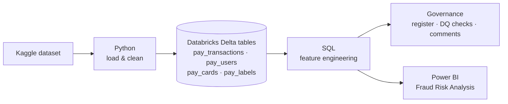

[README(7).md](https://github.com/user-attachments/files/33591941/README.7.md)
# Payments Fraud Risk Analysis

**From raw card payment data to a fraud and customer-risk dashboard, built with Python and SQL on Databricks and visualised in Power BI.**

The project takes a public dataset of card transactions, customers, cards and fraud labels, loads it into Databricks, cleans it, and adds new features that describe **how** customers pay, **where** money is spent, **what kind of customer** they are and **how risky** their financial profile is. Every feature is documented and checked in a governance notebook. The final tables feed a four-page **Power BI report** that answers one question from several angles: *where is the money going, and which customers and transactions look risky?*

| File | What it is |
|------|------------|
| [`payments_data_transformation.ipynb`](payments_data_transformation.ipynb) | Loads, cleans and enriches the data |
| [`payments_data_governance.ipynb`](payments_data_governance.ipynb) | Feature register, data quality checks, column documentation |
| [`Fraud_Risk_Analysis.pbix`](Fraud_Risk_Analysis.pbix) | Power BI report built on the final tables |

---

## Contents

1. [Goal](#1-goal)
2. [Data](#2-data)
3. [How the project is built](#3-how-the-project-is-built)
4. [Data preparation](#4-data-preparation)
5. [Transaction features](#5-transaction-features)
6. [Customer features](#6-customer-features)
7. [Data governance](#7-data-governance)
8. [Power BI dashboard](#8-power-bi-dashboard)
9. [Repository structure](#9-repository-structure)

---

## 1. Goal

Raw payment data is hard to read. Amounts are stored as text (`$-77.00`), each customer is spread across thousands of rows, and nothing tells you whether a payment was online, which customers matter most or which ones carry risk.

The aim was to turn that data into a clear picture of payments and fraud risk, in two steps:

1. **Build the features** in Databricks: payment channel, city spending level, customer segment, financial ratios, credit risk and a rule-based fraud risk level.
2. **Visualise them** in Power BI, so that anyone can explore the transactions, the merchants and the customers, and filter everything by fraud / no fraud.

---

## 2. Data

**Source:** [Transactions Fraud Datasets](https://www.kaggle.com/datasets/computingvictor/transactions-fraud-datasets) on Kaggle (`computingvictor/transactions-fraud-datasets`).

| File | Content | Table |
|------|---------|-------|
| `transactions_data.csv` | One row per card transaction (2010–2019, 13M+ rows) | `pay_transactions` |
| `users_data.csv` | One row per customer: age, gender, address, income, debt, credit score | `pay_users` |
| `cards_data.csv` | One row per card: brand, type, credit limit | `pay_cards` |
| `train_fraud_labels.json` | Fraud label (`Yes` / `No`) for each transaction | `pay_labels` |

Only transactions from **2010 and 2011** are loaded, to keep the tables a manageable size. The dataset is not stored in this repository: the notebook downloads it from Kaggle with `kagglehub`.

---

## 3. How the project is built



| Layer | Tool | Role |
|-------|------|------|
| Ingestion | Python (pandas, Spark) | Download, flatten, clean and save the files as Delta tables |
| Transformation | SQL on Databricks | Add the new feature columns to the tables |
| Governance | SQL + Python | Document every feature and test data quality |
| Visualisation | Power BI | Interactive report on the four final tables |

---

## 4. Data preparation

1. **Download** the four files from Kaggle.
2. **Flatten the fraud labels.** The JSON is nested (`{"target": {"7476734": "No", ...}}`) and becomes a two-column table: `transaction_id` and `is_fraud`.
3. **Keep only 2010**, then **append 2011** with the same cleaning.
4. **Convert the amount to a number.** `$-77.00` → `-77.0`. Negative amounts are refunds.
5. **Save** everything as Delta tables in `payments.default`.

---

## 5. Transaction features

Added to `pay_transactions` (one row = one transaction).

### Payment channel: `is_online`

`ONLINE` when `merchant_city` is `'ONLINE'`, otherwise `OFFLINE`. Online and in-store payments behave differently, so the channel is one of the main ways to split the data.

### City spending level: `city_amount_level`

Merchant cities are ranked by total amount spent and split into three equal groups with `NTILE(3)`: **Low**, **Middle** and **High Level**. Transactions without a valid city are labelled `Città non disponibile`.

### Customer segmentation

Each customer is scored on two dimensions, again split into thirds with `NTILE(3)`:

- **Frequency:** how many transactions → `customer_frequency_level`
- **Monetary value:** how much they spend in total → `customer_monetary_level`

The two scores are combined into a Boston-matrix style class, `customer_boston_class`:

| | Low value | Medium value | High value |
|---|---|---|---|
| **High frequency**   | Frequent Value Seekers | Frequent Value Seekers | **Core Champions** |
| **Medium frequency** | Stable | Stable | High-Value Occasional |
| **Low frequency**    | **Watchlist** | Stable | High-Value Occasional |

- **Core Champions:** buy often and spend a lot, the most valuable customers.
- **Frequent Value Seekers:** buy often, spend little or a medium amount.
- **High-Value Occasional:** buy rarely, spend a lot.
- **Watchlist:** buy rarely and spend little, at risk of becoming inactive (not a fraud flag).
- **Stable:** every other combination.

---

## 6. Customer features

Added to `pay_users` (one row = one customer).

### Clean money columns

`yearly_income`, `total_debt` and `per_capita_income` are text such as `$59,696`. `REGEXP_REPLACE` removes `$` and `,` and `TRY_CAST` turns the result into a number.

### Financial ratios

| Feature | Formula | Meaning |
|---------|---------|---------|
| `debt_to_income` | total_debt / yearly_income | Debt compared with a year of income (above 1 = debt larger than income) |
| `income_vs_area` | yearly_income / per_capita_income | Income compared with the area average (1 = average) |
| `debt_per_card` | total_debt / num_credit_cards | Average debt per card |
| `years_to_retirement` | retirement_age − current_age | Years left before retirement |

### Bands

| `credit_band` | Credit score | | `generation` | Birth year |
|---|---|---|---|---|
| Poor | < 580 | | Gen Z | ≥ 1997 |
| Fair | 580–669 | | Millennial | 1981–1996 |
| Good | 670–739 | | Gen X | 1965–1980 |
| Very Good | 740–799 | | Boomer | < 1965 |
| Excellent | ≥ 800 | | | |

Credit bands follow the US FICO ranges.

### Credit risk: `risk_segment`

| Segment | Condition |
|---------|-----------|
| **Alto** | credit score < 620 **or** debt > 1.5 × yearly income |
| **Medio** | credit score < 700 **or** debt > 0.8 × yearly income |
| **Basso** | everyone else |

### Fraud risk: `fraud_risk_level`

Business rules that flag financial profiles often linked to fraud, such as synthetic or stolen identities and "bust-out" fraud (opening many cards and maxing them out).

| Level | Condition | Why |
|-------|-----------|-----|
| **Critical** | debt > 3 × yearly income | Debt far beyond what the income could repay |
| **Critical** | 6+ cards **and** income below the area average | Many cards on a low income: possible bust-out |
| **Suspicious** | debt > 2 × yearly income | Very high indebtedness |
| **Suspicious** | income > 5 × the area average | Income unusually high for the area: possibly declared falsely |
| **Normal** | everyone else | |

---

## 7. Data governance

The governance notebook makes every feature documented, tested and traceable.

| Table | Content |
|-------|---------|
| `feature_register` | **19 features** with business definition, source columns, SQL logic, NULL handling, allowed values, owner, sensitivity and GDPR flag |
| `dq_check_register` | **14 data quality checks** in SQL: completeness, validity, uniqueness, consistency, integrity |
| `dq_check_results` | Result of each run (PASS / FAIL / ERROR), kept as history |

Feature definitions are also written as **column comments**, so they show up in Databricks Catalog Explorer.

**Privacy:** customer features are personal data under GDPR. `risk_segment`, `fraud_risk_level` and `is_fraud` are classified as **Restricted**, and customer profiling is meant to support human review, not automated decisions (GDPR Art. 22).

---

## 8. Power BI dashboard

`Fraud_Risk_Analysis.pbix` is built on the four Databricks tables (`pay_transactions`, `pay_users`, `pay_cards`, `pay_labels`). It has four pages that move from the big picture down to the single customer. Every page has a **date slicer** and an **"Is there a Fraud?"** filter, so each view can be compared between fraudulent and legitimate transactions.

### Page 1 · Overview: *Fraud Detection Overview*

**Question:** how much money moves, where, how, and how much of it is fraud?

| Visual | What it shows |
|--------|---------------|
| KPI cards | Total transactions and total customers |
| Map | Amount spent by customer location (latitude / longitude), bubble size = amount |
| Pie: *Credit Cards Distributions* | Amount by card brand |
| Pie: *Fraud Transactions?* | Share of the amount that is fraud vs. legitimate |
| Pie: *Online/Offline?* | Share of the amount spent online vs. in store |
| Line: *Monthly Line Chart* | Amount by month, one line per year (2010 vs. 2011) |
| Combo: *Credit Cards Distribution* | Amount by number of cards held per customer, split by year |

Filters: date, fraud yes/no, gender.

### Page 2 · Merchant Analysis: *Fraud Business Level Classification*

**Question:** where is the money spent, and which merchants and customer segments drive it?

| Visual | What it shows |
|--------|---------------|
| Bar: *Merchant City Level* | Top 20 merchant cities by amount |
| Donut: *Categories Amount* | Amount by city spending level (Low / Middle / High) |
| Pie: *Boston Matrix Application* | Amount by customer class (Core Champions, Watchlist, …) |
| Area: *Merchant ID Amount* | Amount by merchant |
| Line: *Merchant ID Line Flow* | Monthly trend of the top 10 merchants |
| Treemap: *Top 10 Merchant ID* | Top 10 merchant categories (MCC) by amount |

Filters: date, fraud yes/no, online/offline.

### Page 3 · Customer Credit Analysis: *Customer Level Analysis*

**Question:** what is the financial profile of the customers: how much do they earn and how much do they owe?

| Visual | What it shows |
|--------|---------------|
| KPI cards | Total yearly income, total per-capita income of their areas, total debt |
| Donut: *Top 10 Customer Analysis* | The 10 customers with the highest yearly income |
| Column: *Yearly Income Amount* | Yearly income per customer |
| Ribbon: *Per Capita Income Amount* | Per-capita income of each customer's area |
| Line: *Debt Amount* | Total debt per customer |

Filters: date, fraud yes/no, online/offline.

### Page 4 · Client Insider: *Client Insider Analytics*

**Question:** which customers carry credit and fraud risk, and what do they look like?

| Visual | What it shows |
|--------|---------------|
| KPI cards | Average debt-to-income, average debt per card, average years to retirement, fraud rate |
| Column: *Id by Generation and Credit Band* | Number of customers per generation, split by credit band |
| Donut: *Total Credit Categories* | Number of customers per credit band |
| Bar: *Fraud Risk Level* | Number of customers per fraud risk level (Normal / Suspicious / Critical) |
| Scatter: *Statistical Dispersion Analysis* | Debt-to-income vs. credit score, coloured by credit band: shows how indebtedness and credit quality relate |

Filters: date, fraud yes/no, credit band, customer ID (to zoom in on a single customer).

---

## 9. Repository structure

```
payments-fraud-risk-analysis/
├── payments_data_transformation.ipynb   # Loading, cleaning, feature engineering
├── payments_data_governance.ipynb       # Feature register, DQ checks, column comments
├── Fraud_Risk_Analysis.pbix             # Power BI report (4 pages)
├── requirements.txt                     # Python libraries
└── README.md
```
