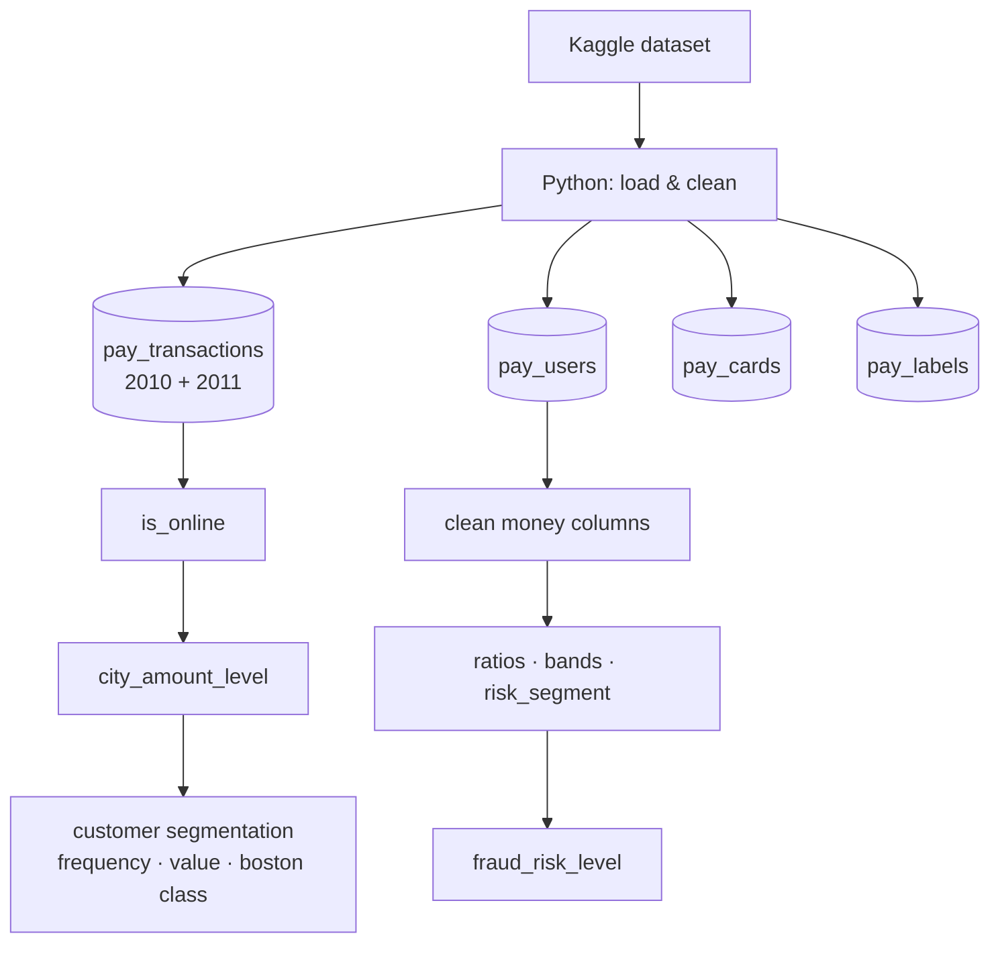

[README(6).md](https://github.com/user-attachments/files/33544968/README.6.md)
# Payments Data Transformation & Governance

**Turning raw card payment data into analysis-ready features with Python and SQL on Databricks.**

This project loads a public dataset of card transactions, customers and fraud labels into Databricks, cleans it and builds new features that describe **how** customers pay, **where** money is spent, **which type of customer** they are and **how risky** their financial profile is. A second notebook documents every feature and checks the data quality (data governance).

| Notebook | What it does |
|----------|--------------|
| [`payments_data_transformation`](payments_data_transformation.ipynb) | Loads the data, cleans it and builds all the features, with explanations and checks at every step |
| [`payments_data_governance`](payments_data_governance.ipynb) | Feature register, data quality checks and column documentation |

---

## Table of contents

1. [The goal](#1-the-goal)
2. [The data](#2-the-data)
3. [Pipeline overview](#3-pipeline-overview)
4. [Data loading](#4-data-loading)
5. [Transaction features](#5-transaction-features)
6. [User features](#6-user-features)
7. [Data governance](#7-data-governance)
8. [Limitations and next steps](#8-limitations-and-next-steps)
9. [How to run](#9-how-to-run)
10. [Repository structure](#10-repository-structure)

---

## 1. The goal

Raw payment data is hard to analyse directly. Amounts are stored as text (`$-77.00`), customers are spread over millions of rows, and nothing says whether a payment was online or which customers matter most.

This project turns the raw data into **clear, reusable features**:

- **Channel:** was the payment made online or in a shop?
- **Location:** is the merchant city a place where a lot of money is spent?
- **Customer segment:** how often does the customer buy, and how much do they spend?
- **Financial profile:** how indebted is the customer, compared with their income and their area?
- **Risk:** what is the customer's credit risk, and do they show financial signals often linked to fraud?

These features are the base for dashboards, customer analysis and fraud detection models.

---

## 2. The data

**Dataset:** [Transactions Fraud Datasets](https://www.kaggle.com/datasets/computingvictor/transactions-fraud-datasets) on Kaggle (`computingvictor/transactions-fraud-datasets`).

| File | Content | Table in Databricks |
|------|---------|---------------------|
| `transactions_data.csv` | One row per card transaction, 2010–2019 (over 13 million rows) | `pay_transactions` |
| `users_data.csv` | One row per customer: age, address, income, debt, credit score | `pay_users` |
| `cards_data.csv` | One row per card: brand, type, credit limit | `pay_cards` |
| `train_fraud_labels.json` | Fraud label (`Yes` / `No`) for each transaction id | `pay_labels` |

To keep the tables manageable, only transactions from **2010 and 2011** are loaded.

The dataset is **not included** in this repository. The notebook downloads it automatically from Kaggle with `kagglehub`.

---

## 3. Pipeline overview



Data is loaded with **Python** (pandas + Spark) and transformed with **SQL**. Each SQL step adds new columns to the table and saves it again with `CREATE OR REPLACE TABLE`.

---

## 4. Data loading

Done in Python:

1. **Download** the four files from Kaggle with `kagglehub`.
2. **Flatten the fraud labels.** The JSON has the nested form `{"target": {"7476734": "No", ...}}`. It is turned into a table with two columns, `transaction_id` (converted to integer to match the transaction `id`) and `is_fraud`.
3. **Filter transactions by year.** Only rows whose `date` starts with `2010` are kept.
4. **Clean the amount.** `amount` is text such as `$-77.00`. `.str[1:]` removes the `$` and `.astype(float)` converts the rest to a number. Negative amounts are **refunds**.
5. **Save as Delta tables** in `payments.default` with `saveAsTable`.
6. **Add 2011.** The 2011 transactions get the same cleaning and are **appended** to `pay_transactions`.

---

## 5. Transaction features

All features are added to `pay_transactions` (one row = one transaction).

### 5.1 Channel: `is_online`

```sql
CASE WHEN merchant_city = 'ONLINE' THEN 'ONLINE' ELSE 'OFFLINE' END
```

Online purchases have no physical shop, so their `merchant_city` is the word `ONLINE`. Every other value is a real city. Online and in-store payments behave differently, so the channel is one of the most useful ways to split the data.

### 5.2 City spending level: `city_amount_level`

Classifies each merchant city as **Low**, **Middle** or **High Level** by the total money spent there.

1. **`city_totals`:** adds up `amount` for each city, skipping empty cities and missing amounts.
2. **`city_groups`:** sorts the cities by total and splits them into **three groups of equal size** with `NTILE(3)`.
3. **Final join:** a `LEFT JOIN` brings the level back to every transaction of that city. Transactions without a valid city get `'Città non disponibile'` through `COALESCE`.

> **`NTILE(3)`** sorts the rows and divides them into 3 groups with the same number of rows: 1 = bottom third, 2 = middle third, 3 = top third.

### 5.3 Customer segmentation

Each customer gets three labels, based on **frequency** (how many transactions) and **monetary value** (how much they spend in total).

1. **`customer_aggregation`:** for each `client_id`, counts the transactions and sums the amounts.
2. **`customer_scores`:** splits customers into thirds twice with `NTILE(3)`, once by frequency and once by value.
3. **`customer_segments`:** turns the thirds into labels.
4. **Final join:** adds the labels to every transaction of the customer. Customers that could not be scored get `'Non classificato'`.

| Column | Values |
|--------|--------|
| `customer_frequency_level` | Bassa frequenza · Media frequenza · Alta frequenza |
| `customer_monetary_level` | Basso valore · Medio valore · Alto valore |
| `customer_boston_class` | See the matrix below |

**`customer_boston_class`**, a Boston-matrix style segmentation:

| | Value: low (1) | Value: medium (2) | Value: high (3) |
|---|---|---|---|
| **Frequency: high (3)**   | Frequent Value Seekers | Frequent Value Seekers | **Core Champions** |
| **Frequency: medium (2)** | Stable | Stable | High-Value Occasional |
| **Frequency: low (1)**    | **Watchlist** | Stable | High-Value Occasional |

- **Core Champions:** buy often and spend a lot. These are the most valuable customers.
- **Frequent Value Seekers:** buy often but spend little or a medium amount.
- **High-Value Occasional:** buy rarely but spend a lot.
- **Watchlist:** buy rarely and spend little. These customers are at risk of becoming inactive; the name does *not* mean suspected fraud.
- **Stable:** all the other combinations.

---

## 6. User features

All features are added to `pay_users` (one row = one customer).

### 6.1 Cleaning the money columns

`yearly_income`, `total_debt` and `per_capita_income` are stored as text such as `$59,696`.

```sql
TRY_CAST(REGEXP_REPLACE(yearly_income, '[$,]', '') AS DOUBLE)
```

- `REGEXP_REPLACE(..., '[$,]', '')` removes every `$` and `,`.
- `TRY_CAST(... AS DOUBLE)` converts the result into a number, returning **NULL** instead of an error if a value cannot be converted.

### 6.2 Financial ratios

`NULLIF(x, 0)` turns a zero into NULL, so a division by zero gives NULL instead of an error.

| Feature | Formula | Meaning |
|---------|---------|---------|
| `debt_to_income` | total_debt / yearly_income | How many years of income the debt is worth. Above 1 = debt larger than a year's income |
| `income_vs_area` | yearly_income / per_capita_income | Income compared with the area average. 1 = average, 2 = double |
| `debt_per_card` | total_debt / num_credit_cards | Average debt for each card held |
| `years_to_retirement` | retirement_age − current_age | Years left before retirement. Negative = already retired |

### 6.3 Bands

| `credit_band` | Credit score | | `generation` | Birth year |
|---|---|---|---|---|
| Poor | below 580 | | Gen Z | 1997 or later |
| Fair | 580–669 | | Millennial | 1981–1996 |
| Good | 670–739 | | Gen X | 1965–1980 |
| Very Good | 740–799 | | Boomer | before 1965 |
| Excellent | 800 or more | | | |

The credit bands follow the FICO score ranges used in the US.

### 6.4 Credit risk: `risk_segment`

Conditions are checked in order, and the first true one decides the segment.

| Segment | Condition |
|---------|-----------|
| **Alto** | credit score below 620, **or** debt more than 1.5 × yearly income |
| **Medio** | credit score below 700, **or** debt more than 0.8 × yearly income |
| **Basso** | everyone else |

### 6.5 Rule-based fraud risk: `fraud_risk_level`

Flags customers whose financial profile shows signals often linked to fraud, such as synthetic or stolen identities, or "bust-out" fraud (opening many cards and maxing them out).

| Level | Condition | Why it is a signal |
|-------|-----------|--------------------|
| **Critical** | debt more than 3 × yearly income | Debt far beyond what the income could repay |
| **Critical** | 6 or more cards **and** income below the area average | Many cards with a low income: possible bust-out |
| **Suspicious** | debt more than 2 × yearly income | Very high indebtedness |
| **Suspicious** | income more than 5 × the area average | Income unusually high for the area: possibly declared falsely |
| **Normal** | everyone else | |

These thresholds are **business rules chosen by hand**, not learned from data.

---

## 7. Data governance

The [`payments_data_governance`](payments_data_governance.ipynb) notebook makes the features documented, checked and traceable.

| Table | Content |
|-------|---------|
| `feature_register` | **19 features**, each with business definition, source columns, dependencies, SQL logic, NULL handling, allowed values, owner and steward, sensitivity, GDPR flag, critical data element flag, quality rule and known issues |
| `dq_check_register` | **14 data quality checks** written as SQL, covering completeness, validity, uniqueness, consistency and integrity |
| `dq_check_results` | Outcome (PASS / FAIL / ERROR) of every check run, kept as history |

The notebook also copies each feature definition onto the **column comments** of the tables, so they are visible in Catalog Explorer.

**Privacy:** all `pay_users` features are **personal data** under GDPR. `risk_segment`, `fraud_risk_level` and `is_fraud` are classified as **Restricted**. Customer profiling (`customer_boston_class`, `risk_segment`, `fraud_risk_level`) must not lead to automated decisions about a customer without human review (GDPR Art. 22). Age-related features such as `generation` must not be used in credit or fraud decisions.

---

## 8. Limitations and next steps

**Limitations found during the governance review**

- **Steps cannot be re-run on their own.** Each SQL step rebuilds a table from itself (`CREATE OR REPLACE TABLE x AS SELECT * FROM x`), so running a single step twice fails with a duplicate column error. The 2011 load uses `append`, so running it twice duplicates the year.
- **Missing values fall into the `ELSE` branch.** A missing `credit_score` becomes *Excellent*, a missing `birth_year` becomes *Boomer*, and missing financial data counts as low risk.
- **`fraud_risk_level` has not been validated** against the real fraud labels in `pay_labels`.
- **Segments depend on the data loaded.** Thirds are recomputed on all the years in the table, so they change when new years are added.
- **Mixed languages** in the labels (for example *Alto / Medio / Basso* next to *Poor / Good*).

**Next steps**

- Make each step **idempotent** by building every table from the raw data (or using separate bronze / silver / gold tables) instead of from itself.
- Handle **NULLs explicitly** in the `CASE` expressions (for example `'Unknown'`).
- **Validate `fraud_risk_level`** by comparing it with the fraud rate in `pay_labels`.
- Use the features in a **fraud detection model** at transaction level.
- Use **one language** for all labels.

---

## 9. How to run

The notebooks are built for **Databricks** with Unity Catalog. They use Spark and the `payments.default` schema.

1. In Databricks, go to **Workspace → ⋮ → Import** and import both notebooks.
2. Attach them to a cluster.
3. Open `payments_data_transformation` and click **Run all**. Run it **once, from top to bottom**.
4. Then open `payments_data_governance` and click **Run all**.

If you use a different catalog, replace `payments.default` in both notebooks.

**Libraries:** `kagglehub`, `pandas` (pyspark is already available on Databricks).

```bash
pip install -r requirements.txt
```

---

## 10. Repository structure

```
payments-data-transformation/
├── payments_data_transformation.ipynb   # Loading, cleaning and feature engineering
├── payments_data_governance.ipynb       # Feature register, DQ checks, column comments
├── requirements.txt                     # Python libraries
└── README.md                            # This file
```
