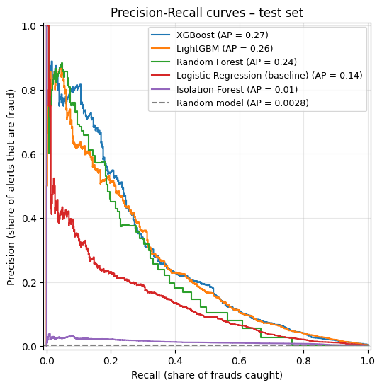
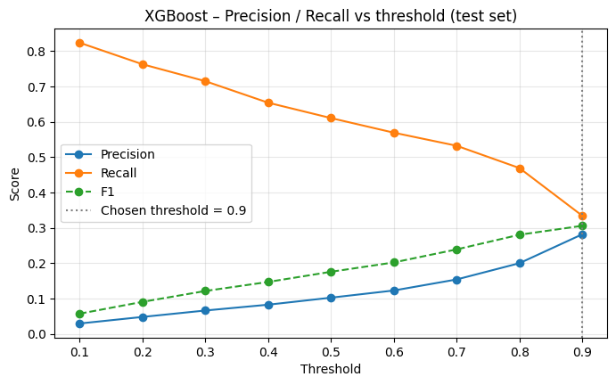
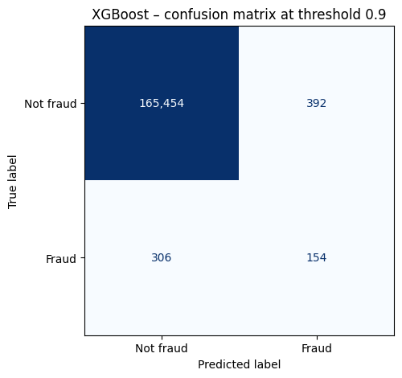
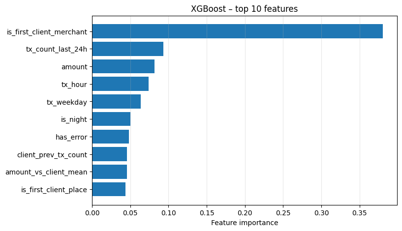

# Fraud Detection on Card Transactions – Databricks + Power BI

End-to-end fraud detection project on the **Client Insider** payment data:
explore the data on Databricks, build leakage-free features, train and compare models with a **time-based split**,
choose a decision threshold, score **every transaction** into a new Delta table (`fraud_scores`) and show the results in **Power BI**.

| | |
|---|---|
| **Data** | `payments.default` on Databricks (Unity Catalog) – 1,240,880 card transactions (2010) |
| **Label** | `pay_labels.is_fraud` (Yes / No) – 0.309% fraud on labelled transactions |
| **Final model** | XGBoost (`xgboost_v1`), threshold **0.9** |
| **Test result** | PR-AUC **0.2748** (2× the Logistic Regression baseline, ~98× random) – catches **154 of 460** frauds with **392** false alarms |
| **Output** | Delta table `payments.default.fraud_scores` (one row per transaction) + Power BI dashboards |

---

## Repository structure

```
├── README.md
├── Fraud_Analysis_Official_steps.ipynb      # Databricks notebook, Steps 1–8, with outputs
├── Fraud_Risk_Analysis_final_version.pbit   # Client Insider report (4 dashboards)
├── Fraud_Score.pbit                         # Fraud Risk report (fraud_scores dashboard)
└── images/                                  # charts from the notebook (Steps 6 and 7)
```

## Rules followed

- **Read-only on the existing tables.** `pay_transactions`, `pay_labels`, `pay_users` and `pay_cards` are only read. The only table written is the new `fraud_scores`.
- **No CSV exports.** All data stays on Databricks; Power BI reads it through the Databricks connector.
- **No data leakage.** Features only use each client's past, and the model is evaluated on transactions that happen *after* the training period.

## Table of contents

1. [Find and explore the data](#1-find-and-explore-the-data)
2. [Feature engineering](#2-feature-engineering)
3. [Time-based train / test split](#3-time-based-train--test-split)
4. [Baseline model – Logistic Regression](#4-baseline-model--logistic-regression)
5. [Stronger models](#5-stronger-models)
6. [Model comparison](#6-model-comparison)
7. [Final model, threshold and conclusion](#7-final-model-threshold-and-conclusion)
8. [Scoring, `fraud_scores` table and Power BI dashboards](#8-scoring-fraud_scores-table-and-power-bi-dashboards)
9. [Limitations and data notes](#9-limitations-and-data-notes)
10. [How to reproduce](#10-how-to-reproduce)

---

## 1. Find and explore the data

**Source tables** (schema `payments.default`):

| Table | Content | Used for |
|---|---|---|
| `pay_transactions` | Card transactions | Features, scoring, dashboards |
| `pay_labels` | `transaction_id`, `is_fraud` (Yes/No) | Fraud label |
| `pay_users` | Client profile (income, debt, credit score…) | Dashboards |
| `pay_cards` | Card profile (brand, type, limit…) | Dashboards |

**`pay_transactions` at a glance**

- **1,240,880 rows, 12 columns**, all from **2010** (2010-01-01 → 2010-12-31).
- `id` is a **unique transaction ID**: 1,240,880 distinct values, no nulls, no duplicates.
- Channel (`use_chip`): 1,106,058 swipe and 134,822 online transactions.
- `amount`: from −500 (refunds) to 6,820.20, mean 43.70.
- Missing values: `merchant_state` 134,822 and `zip` 142,042 (empty for online / foreign transactions); `errors` is empty for 1,221,497 transactions (only 19,383 have an error).

**Column dictionary**

| Column | Meaning |
|---|---|
| `id` | **Unique transaction ID** (key used to join the scores in Step 8) |
| `date` | Date and time of the transaction |
| `client_id` | Client who made the transaction → `pay_users.id` |
| `card_id` | Card used → `pay_cards.id` |
| `amount` | Amount in USD; negative values are refunds |
| `use_chip` | Channel: Swipe Transaction / Online Transaction |
| `merchant_id` | Merchant ID |
| `merchant_city` | Merchant city (`ONLINE` for online transactions) |
| `merchant_state` | US state, or country for foreign transactions; empty for online |
| `zip` | Merchant ZIP code |
| `mcc` | Merchant Category Code (type of business) |
| `errors` | Error raised on the transaction (Insufficient Balance, Bad PIN, Bad CVV…) |

**Fraud label**

There is **no fraud column inside `pay_transactions`**. The labels are in a separate table, `pay_labels`
(8,914,963 rows, 13,332 frauds), joined on `pay_transactions.id = pay_labels.transaction_id`.

| | Transactions |
|---|---|
| In `pay_transactions` | 1,240,880 |
| With a label | 831,529 (67.01%) |
| Labelled as fraud | **2,573** |
| **Fraud % on labelled transactions** | **0.309%** |
| Fraud % on all transactions | 0.207% |

> `pay_users.fraud_risk_level` (Critical / Suspicious / Normal) is a business rule built on debt and income, **not** a fraud label, so it is never used as the target.

---

## 2. Feature engineering

11 new columns, built with **Spark window functions** ordered by time.
Every window only looks at the **current or earlier transactions of the same client**, so no feature uses information from the future.

| Feature | One-line explanation |
|---|---|
| `tx_hour` | Hour of the day (0–23) |
| `tx_weekday` | Day of the week (0 = Monday … 6 = Sunday) |
| `is_night` | 1 if the transaction happens between 00:00 and 05:59 |
| `client_prev_tx_count` | Number of transactions the client made before this one |
| `amount_vs_client_mean` | Amount ÷ the client's average amount on **previous** transactions |
| `tx_count_last_1h` | Other transactions by the same client in the previous hour |
| `tx_count_last_24h` | Other transactions by the same client in the previous 24 hours |
| `seconds_since_prev_tx` | Seconds since the client's previous transaction |
| `is_first_client_merchant` | 1 if it is the first time the client pays this merchant |
| `is_first_client_place` | 1 if it is the first time the client pays in this state / country (or online) |
| `has_error` | 1 if the transaction raised an error |

**Leakage check:** on the first transaction of each of the 1,137 clients, all "past" features are empty (0 / null) – as expected.

**Do the features separate fraud from normal transactions?** (averages on labelled transactions)

| Feature | Not fraud | Fraud |
|---|---|---|
| `is_first_client_merchant` | 8.5% | **62.5%** |
| `amount_vs_client_mean` | 1.02 | **3.03** |
| `tx_count_last_24h` | 3.84 | **6.06** |
| `seconds_since_prev_tx` | 28,256 | **14,193** |
| `is_night` | 5.8% | **13.2%** |
| `tx_hour` | 12.4 | **9.4** |
| `has_error` | 1.6% | **4.4%** |
| `is_first_client_place` | 0.8% | **5.8%** |

Fraud happens far more often at a **new merchant**, with an **amount ~3× higher** than the client's usual, in **bursts** of transactions and **earlier in the day**.

---

## 3. Time-based train / test split

The labelled transactions are sorted by date: the **oldest 80%** are used for training and the **newest 20%** for testing.
No random shuffling – in real life the model is trained on the past and used on the future, and a random split would give results that are too optimistic.

| Part | Rows | Date range | Fraud cases | Fraud % |
|---|---|---|---|---|
| Train (oldest ~80%) | 665,223 | 2010-01-01 00:01 → 2010-10-21 10:00 | 2,113 | 0.318% |
| Test (newest ~20%) | 166,306 | 2010-10-21 10:01 → 2010-12-31 23:54 | 460 | 0.277% |
| **Total** | **831,529** | 2010-01-01 → 2010-12-31 | **2,573** | **0.309%** |

- Cutoff date: **2010-10-21 10:01:00**; every train transaction is earlier than every test transaction.
- Both parts contain fraud cases, and the fraud rate is similar (test = 0.87× train), so there is no strong drift in the label.
- Classes are very unbalanced (~3 frauds every 1,000 transactions), so **accuracy is not used**: the metrics are Precision, Recall and **PR-AUC**.

---

## 4. Baseline model – Logistic Regression

Pipeline fitted **on train only**: median imputation (+ missing-value flags) → `StandardScaler` → `LogisticRegression(class_weight='balanced')`.

| Model | Precision | Recall | PR-AUC | F1 | ROC-AUC |
|---|---|---|---|---|---|
| Logistic Regression (balanced), threshold 0.5 | 0.0406 | 0.6826 | **0.1405** | 0.0766 | 0.9203 |
| Random model (reference) | – | – | 0.0028 | – | – |

- Catches **314 of 460 frauds** (68%) but raises **7,425 false alarms** – about 24 alerts for every real fraud.
- PR-AUC is **50.8× better than random**. This is the benchmark every next model has to beat.
- Strongest signals (largest coefficients): earlier hour of the day (−1.01), many transactions in the last 24 h (+0.81), first time at the merchant (+0.80), short gap since the previous transaction (−0.53).

---

## 5. Stronger models

All models use the **same `X_train / y_train`** as the baseline and are scored on the same test set.

| Model | Imbalance handling | PR-AUC | ROC-AUC | Precision@0.5 | Recall@0.5 | vs baseline |
|---|---|---|---|---|---|---|
| **XGBoost** | `scale_pos_weight` = 313.8 | **0.2748** | 0.9563 | 0.1029 | 0.6109 | **1.96×** |
| LightGBM | `class_weight='balanced'` | 0.2570 | 0.9551 | 0.1386 | 0.5522 | 1.83× |
| Random Forest | `class_weight='balanced'` | 0.2378 | 0.8644 | 1.0000 | 0.0065 | 1.69× |
| Logistic Regression (baseline) | `class_weight='balanced'` | 0.1405 | 0.9203 | 0.0406 | 0.6826 | 1.00× |
| Isolation Forest (unsupervised) | label not used | 0.0131 | 0.7874 | – | – | 0.09× |

- **XGBoost and LightGBM almost double** the baseline PR-AUC.
- **Random Forest** ranks frauds well, but its probabilities rarely reach 0.5: at that threshold it flags only 3 transactions, so its threshold would need to be lowered.
- **Isolation Forest** performs far below the baseline: without the label, these frauds do not stand out as outliers.

---

## 6. Model comparison

| Model | Precision | Recall | PR-AUC |
|---|---|---|---|
| **XGBoost** | 0.1029 | 0.6109 | **0.2748** |
| LightGBM | 0.1386 | 0.5522 | 0.2570 |
| Random Forest | 1.0000 | 0.0065 | 0.2378 |
| Logistic Regression (baseline) | 0.0406 | 0.6826 | 0.1405 |
| Isolation Forest | 0.0227 | 0.0261 | 0.0131 |

*Precision and Recall at the 0.5 threshold; Isolation Forest flags the top 0.32% most anomalous transactions.*



**The best model is XGBoost**: highest PR-AUC (0.2748, about 2× the Logistic Regression baseline), ahead of LightGBM (0.2570). Its curve stays above the others for almost every level of recall.

---

## 7. Final model, threshold and conclusion

**Precision and Recall of XGBoost at different thresholds (test set)**

| Threshold | Precision | Recall | F1 | Alerts | Frauds caught | False alarms | Frauds missed |
|---|---|---|---|---|---|---|---|
| 0.1 | 0.0299 | 0.8239 | 0.0577 | 12,686 | 379 | 12,307 | 81 |
| 0.2 | 0.0484 | 0.7630 | 0.0911 | 7,250 | 351 | 6,899 | 109 |
| 0.3 | 0.0666 | 0.7152 | 0.1218 | 4,941 | 329 | 4,612 | 131 |
| 0.4 | 0.0830 | 0.6543 | 0.1474 | 3,625 | 301 | 3,324 | 159 |
| 0.5 | 0.1029 | 0.6109 | 0.1761 | 2,731 | 281 | 2,450 | 179 |
| 0.6 | 0.1232 | 0.5696 | 0.2026 | 2,127 | 262 | 1,865 | 198 |
| 0.7 | 0.1544 | 0.5326 | 0.2394 | 1,587 | 245 | 1,342 | 215 |
| 0.8 | 0.2004 | 0.4696 | 0.2809 | 1,078 | 216 | 862 | 244 |
| **0.9** | **0.2821** | **0.3348** | **0.3062** | **546** | **154** | **392** | **306** |



**Chosen threshold: 0.9** – the best F1 among the values tried, and an alert volume a fraud team can review: 546 alerts in about 10 weeks, roughly 8 per day.

**Confusion matrix at threshold 0.9**

| | Predicted not fraud | Predicted fraud |
|---|---|---|
| **Actual not fraud** | 165,454 (TN) | 392 (FP) |
| **Actual fraud** | 306 (FN) | 154 (TP) |



**Top 10 features (XGBoost importance)**

| # | Feature | Importance |
|---|---|---|
| 1 | `is_first_client_merchant` | 0.380 |
| 2 | `tx_count_last_24h` | 0.093 |
| 3 | `amount` | 0.082 |
| 4 | `tx_hour` | 0.074 |
| 5 | `tx_weekday` | 0.064 |
| 6 | `is_night` | 0.050 |
| 7 | `has_error` | 0.048 |
| 8 | `client_prev_tx_count` | 0.046 |
| 9 | `amount_vs_client_mean` | 0.045 |
| 10 | `is_first_client_place` | 0.044 |



**Conclusion**

The final model is **XGBoost**, because it has the highest PR-AUC (0.2748), about twice the Logistic Regression baseline.
With a **threshold of 0.9** it **catches 154 of the 460 frauds** in the test period (33%) and raises **392 false alarms** out of 165,846 normal transactions (0.24%):
more than 1 alert in 4 is a real fraud, against about 1 in 25 for the baseline.
If missing a fraud costs more than checking an alert, the threshold can be lowered to 0.7, which catches 53% of frauds at the price of 1,342 false alarms.
By far the strongest signal is a payment at a **merchant the client has never used before**, followed by the number of transactions in the last 24 hours and the amount.

---

## 8. Scoring, `fraud_scores` table and Power BI dashboards

### 8.1 Scoring every transaction

The XGBoost model and the 0.9 threshold are applied to **all 1,240,880 transactions** (not only the test set) and saved in a **new Delta table**:

`payments.default.fraud_scores`

| Column | Type | Meaning |
|---|---|---|
| `transaction_id` | long | Same ID as `pay_transactions.id` (join key) |
| `fraud_probability` | double | Fraud probability from 0 to 1 |
| `is_flagged` | boolean | `true` if `fraud_probability ≥ 0.9` |
| `model_name` | string | `xgboost_v1` |
| `scored_at` | timestamp | Date and time of the scoring run (UTC) |

**Checks**

| Check | Result |
|---|---|
| Rows in `pay_transactions` | 1,240,880 |
| Rows in `fraud_scores` | 1,240,880 (1,240,880 distinct `transaction_id`) |
| Transactions without a score | **0** ✅ |
| Flagged transactions | **10,922** (0.88%) – average probability 0.949 |
| Not flagged | 1,229,958 – average probability 0.066 |
| Test-set flags vs Step 7 confusion matrix | TP = 154, FP = 392 – identical ✅ |

The existing tables are not changed: the scores live in their own table and are joined on `transaction_id`.
In the notebook preview, the highest-risk transactions (probability ≈ 0.998) are all **online payments made early in the morning**,
and the client with the most alerts has 64 flagged transactions out of 3,770 (1.7%).

### 8.2 Power BI dashboards

The project has **5 dashboards** in two Power BI reports. Both connect to Databricks with the **Databricks** connector.

| # | Dashboard | Report file | Main tables |
|---|---|---|---|
| 1 | Overview | `Fraud_Risk_Analysis_final_version.pbit` | `pay_transactions`, `pay_labels`, `pay_users`, `pay_cards` |
| 2 | Merchants | `Fraud_Risk_Analysis_final_version.pbit` | `pay_transactions`, `pay_labels` |
| 3 | Customers | `Fraud_Risk_Analysis_final_version.pbit` | `pay_users`, `pay_transactions`, `pay_labels` |
| 4 | Client Insider | `Fraud_Risk_Analysis_final_version.pbit` | `pay_users`, `pay_labels` |
| 5 | **Fraud Risk** (new) | `Fraud_Score.pbit` | `fraud_scores`, `pay_transactions` |

All pages share the same layout: a header, filters at the top (transaction date plus 1–3 page-specific filters), a row of KPI cards and the charts below.

---

#### Dashboard 1 – Overview

*Transactions, fraud exposure and payment channels.*

- **Filters:** transaction date, fraud label, gender.
- **KPI cards:** total transactions, total amount, number of customers, fraud transactions, fraud amount.
- **Charts:**
  - *Transaction amount by customer location* – map of the amount by where the customer lives.
  - *Monthly transaction amount · year over year* – line chart of the amount per month.
  - *Amount by card brand* – bar chart.
  - *Online vs offline amount* – donut chart of the two channels.
  - *Fraud transactions by month* – column chart of when fraud happens.
  - *Amount by number of credit cards held* – column chart.

**Use it for:** a first picture of volumes, channels and how much of the activity is fraud.

---

#### Dashboard 2 – Merchants

*Where the money goes: cities, merchants, MCC categories and customer segments.*

- **Filters:** transaction date, fraud label, channel (online / offline).
- **KPI cards:** total amount, transactions, average ticket, active merchants, merchant cities.
- **Charts:**
  - *Top 20 merchant cities by amount* – bar chart.
  - *Amount by city volume level* – donut chart (low / middle / high volume cities).
  - *Amount by customer segment (Boston matrix)* – bar chart of the client segments.
  - *Top 10 merchants by amount* – bar chart.
  - *Monthly amount · top 5 merchants* – line chart.
  - *Top 10 MCC codes by amount* – treemap of the business categories.

**Use it for:** finding which cities, merchants and business categories carry the most money, and where fraud is concentrated when the fraud filter is set.

---

#### Dashboard 3 – Customers

*Income, debt and credit profile of each customer.*

- **Filters:** transaction date, fraud label, channel.
- **KPI cards:** total yearly income, total debt, average income per capita, customers, average credit score.
- **Charts:**
  - *Top 10 customers by yearly income* – bar chart.
  - *Yearly income vs total debt by generation* – column chart (Gen Z, Millennial, Gen X, Boomer).
  - *Customer detail · sorted by total debt* – table with ID, gender, age, generation, credit band, credit score, income, debt, debt-to-income and fraud risk level.

**Use it for:** looking at single customers and comparing their financial profile.

---

#### Dashboard 4 – Client Insider

*Credit quality, indebtedness and fraud-risk segmentation of the customer base.*

- **Filters:** transaction date, fraud label, credit band, customer ID.
- **KPI cards:** average debt-to-income, average debt per card, average years to retirement, average credit score, fraud risk rate (critical + suspicious customers).
- **Charts:**
  - *Customers by generation and credit band* – column chart.
  - *Customers by credit band* – donut chart (Poor → Excellent).
  - *Debt-to-income vs credit score* – scatter chart, one dot per customer.
  - *Customers by fraud risk level* – bar chart (Critical / Suspicious / Normal).

**Use it for:** segmenting the customer base by credit quality and by the rule-based risk level.

---

#### Dashboard 5 – Fraud Risk (new, from the model)

*XGBoost fraud probability for every transaction · model `xgboost_v1` · threshold 0.9.*

This is the dashboard built for Step 8. It reads the new `fraud_scores` table, joined to `pay_transactions` with a **one-to-one relationship** on `transaction_id` (cross filter in both directions).

- **Filters:** transaction date, flagged by model (true / false), channel.
- **KPI cards** (DAX measures in `fraud_scores`):

  | Card | Measure |
  |---|---|
  | Scored transactions | `COUNTROWS ( fraud_scores )` |
  | Flagged transactions | `CALCULATE ( COUNTROWS ( fraud_scores ), fraud_scores[is_flagged] = TRUE () )` |
  | Flagged % | `DIVIDE ( [Flagged Transactions], [Scored Transactions] )` |
  | Avg fraud probability | `AVERAGE ( fraud_scores[fraud_probability] )` |
  | Flagged amount | `CALCULATE ( SUM ( pay_transactions[amount] ), fraud_scores[is_flagged] = TRUE () )` |

- **Charts:**
  - *Top 50 highest-risk transactions* – table sorted by fraud probability, with transaction ID, date, client, amount, merchant city, MCC and flag. This is the **work list** for the fraud team.
  - *Flagged transactions by month* – column chart of the alert volume over time.
  - *Top 15 clients by flagged transactions* – bar chart.
  - *Flagged transactions per client · number and %* – table with transactions, flagged, flagged % and average probability per client.

**Use it for:** deciding which transactions to check first and which clients to watch.
All filters work across the page, so selecting a client or a month updates the cards and the tables.

> **Why a separate report?** The Step 8 brief suggested adding the scores to the existing Client Insider report.
> The Fraud Risk dashboard was built as its own report instead, so that the four existing dashboards stay exactly as they were.
> Both reports read from the same Databricks schema, and `fraud_scores` can be added to the main report at any time with the same relationship and measures.

---

## 9. Limitations and data notes

- **2010 only.** `pay_transactions` on Databricks currently holds only 2010, although the source notebook was meant to load 2010 and 2011. The 2010 load (`mode('overwrite')`) was run again after the 2011 `append`, which removed the 2011 rows and the dashboard columns (`is_online`, `city_amount_level`, `customer_*`). Following the rules, the table was not changed. The Client Insider report still holds the older 2010–2011 snapshot, so it should **not** be fully refreshed until the table is restored.
- **Label coverage.** Only 67% of the transactions have a label in `pay_labels`; the model is trained and evaluated on those.
- **Optimistic scores on the training period.** Transactions up to 2010-10-21 were used for training, so their probabilities in `fraud_scores` look better than real performance. The honest figures are the test-set ones in Step 7.
- **Threshold.** 0.9 was the highest value tested; a slightly higher threshold, or a business cost for missed frauds vs false alarms, could change the choice.

---

## 10. How to reproduce

1. **Databricks:** import `Fraud_Analysis_Official_steps.ipynb` and run all cells on a Databricks ML runtime (XGBoost and LightGBM are installed by the first cell). The notebook only reads the existing tables and writes `payments.default.fraud_scores`.
2. **Power BI – Client Insider (dashboards 1–4):** open `Fraud_Risk_Analysis_final_version.pbit`.
3. **Power BI – Fraud Risk (dashboard 5):** open `Fraud_Score.pbit`. When asked, enter:
   - `DatabricksHost` – your workspace host (e.g. `dbc-xxxxxxxx-xxxx.cloud.databricks.com`, without `https://`);
   - `DatabricksHttpPath` – from **SQL Warehouses → your warehouse → Connection details** (e.g. `/sql/1.0/warehouses/xxxxxxxxxxxx`);

   then sign in with OAuth or a personal access token.

**Tech stack:** Databricks (PySpark, Delta Lake, Unity Catalog) · pandas · scikit-learn · XGBoost · LightGBM · matplotlib · Power BI (DAX, Databricks connector).
